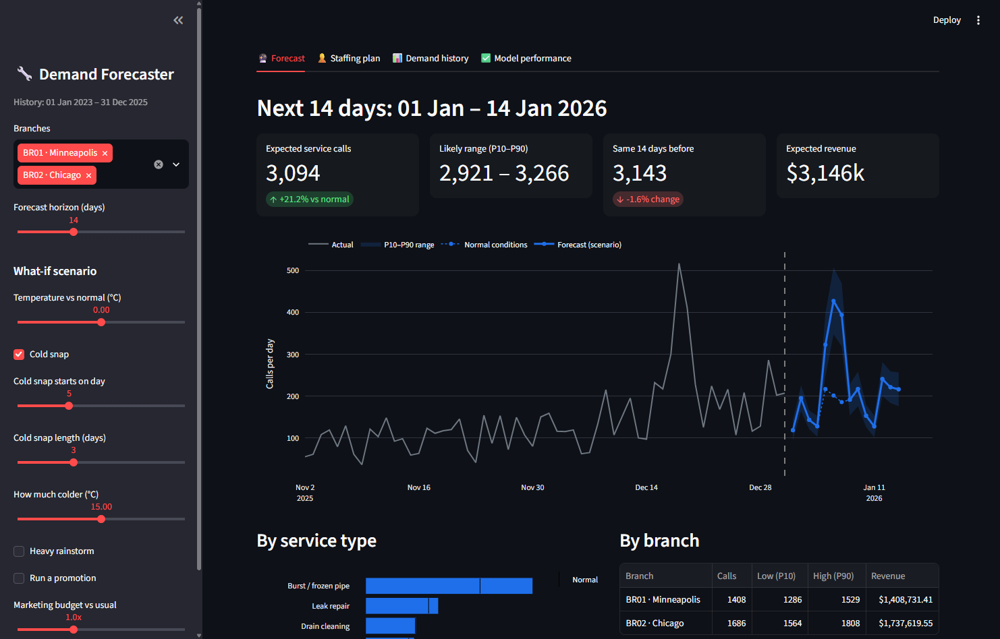
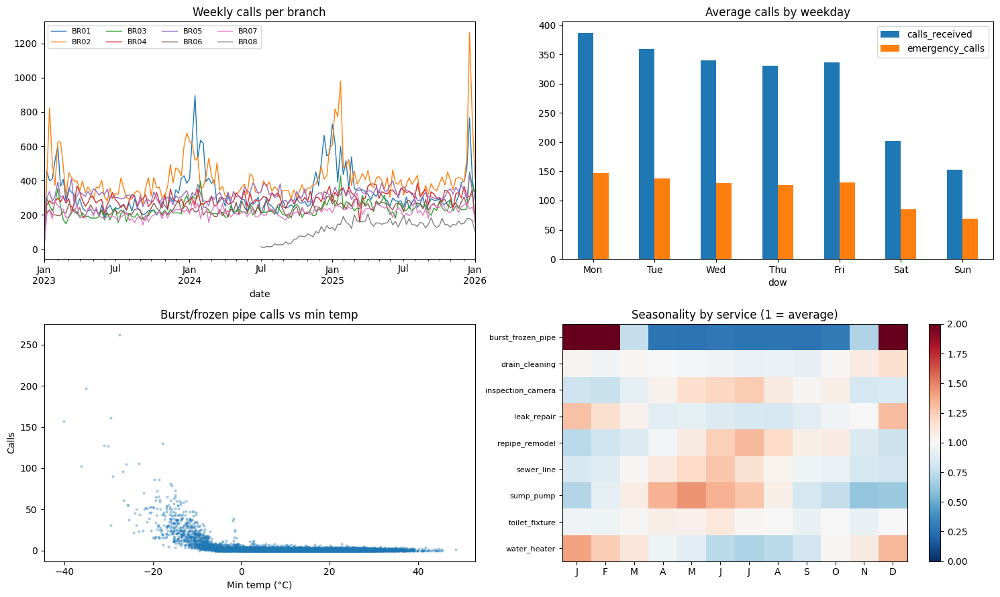
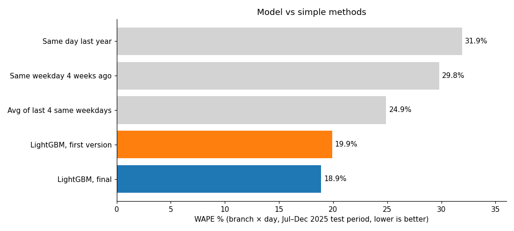
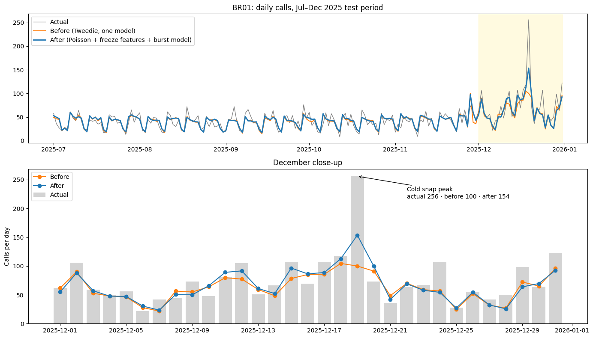
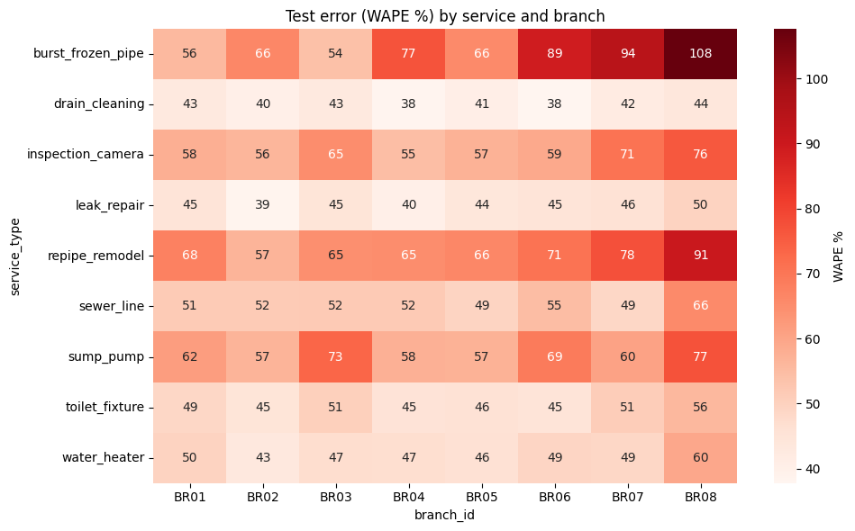
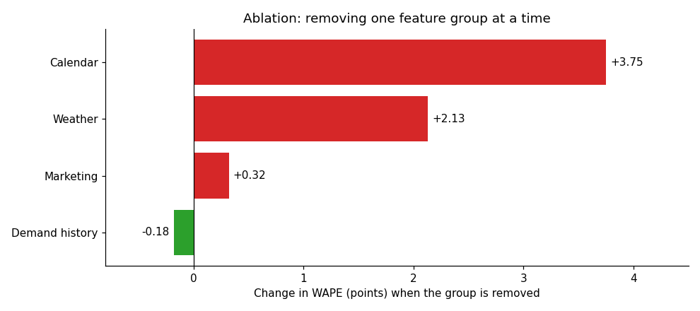
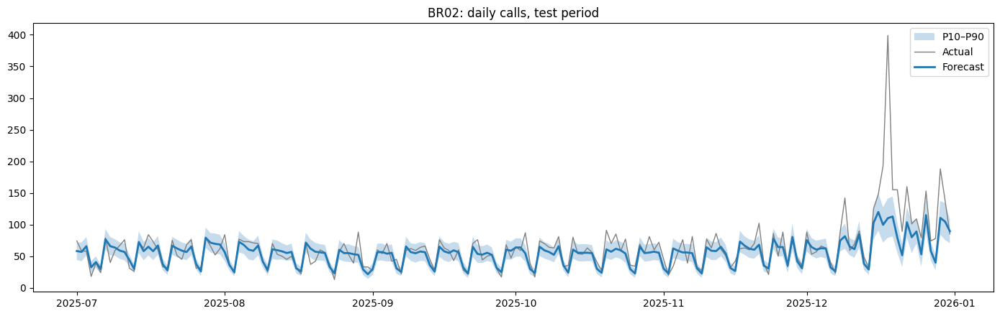
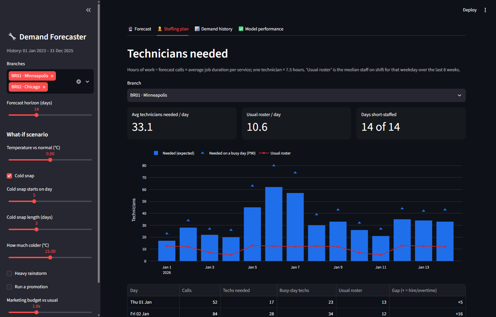

# Plumbing Demand Forecasting

Forecasts daily service calls for each branch and service type of a plumbing services chain (modelled on chains like Mr. Rooter Plumbing), **up to 28 days ahead**, with a likely range, what-if scenarios and a technician staffing plan.

Built as part of the Group 5 project *"Using ML to improve the business of a chain of plumbing services"* (M.Tech CSE, IIT Roorkee).

| | |
|---|---|
| **Error per branch per day (WAPE)** | **18.9%** on an unseen 6-month test period |
| **Best simple method** | 24.9%, so the model makes about **24% less error** |
| **Model** | LightGBM (Poisson) + dedicated burst-pipe model + P10/P90 quantile models |
| **App** | Streamlit, with 4 tabs and what-if controls |
| **Dataset** | [Kaggle: plumbing-demand-dataset](https://www.kaggle.com/datasets/adityaraiiiii/plumbing-demand-dataset) (synthetic, CC0) |



---

## Contents

- [Quick start](#quick-start)
- [The problem](#the-problem)
- [Dataset](#dataset)
- [Method](#method)
- [Results](#results)
- [The app](#the-app)
- [Project structure](#project-structure)
- [Using a model trained in the Kaggle notebook](#using-a-model-trained-in-the-kaggle-notebook)
- [Limitations and next steps](#limitations-and-next-steps)

---

## Quick start

Requires Python 3.10 or newer.

```bash
pip install -r requirements.txt
streamlit run app.py          # opens http://localhost:8501
```

The final model (18.9%) is already in `models/`; it was trained in the Kaggle notebook. `python train.py` retrains a simpler single-model version (Tweedie objective, no burst-pipe model, 19.6%) from the command line, and overwrites `models/`.

The model files are plain text (LightGBM), JSON and CSV, so they load on any pandas or NumPy version.

---

## The problem

A plumbing chain schedules technicians days in advance, but demand depends heavily on the weather. One freezing night can multiply burst-pipe calls twentyfold.

- **Too few technicians:** missed emergency calls, overtime and lost revenue.
- **Too many technicians:** paid hours with no jobs.

**Goal:** predict daily calls per branch and service type, 1–28 days ahead, with a low-to-high range that managers can plan from.

---

## Dataset

Real company data wasn't available, so we generated a realistic synthetic dataset and published it on Kaggle.

| | |
|---|---|
| Branches | 8: Minneapolis, Chicago, Denver, Atlanta, Dallas, Phoenix, Seattle, Charlotte |
| Service types | 9: drain cleaning, leak repair, water heater, toilet/fixture, sewer line, burst/frozen pipe, sump pump, camera inspection, repipe/remodel |
| Period | 1 Jan 2023 – 31 Dec 2025, daily |
| Size | 73,989 branch × service × day rows; 239,532 individual jobs |

| File | Contents |
|---|---|
| `daily_demand.csv` | Main table. Target: `calls_received` |
| `weather_daily.csv` | Temperatures, rain, snow and freeze/heatwave flags per branch |
| `marketing_daily.csv` | Daily spend and promotions per branch |
| `calendar.csv` | Weekday, US holidays, day after Thanksgiving, Christmas week, school holidays |
| `branches.csv` | City, climate zone, opening date, households served, housing age |
| `jobs.csv` | One row per completed job: timestamps, response time, invoice, channel, technician |

**Patterns built in:** growth trends, a Monday peak, seasonality that differs by service, freeze spikes with an extra spike on the thaw day, rain-driven sewer backups, holiday effects, marketing carry-over, and a new branch (BR08 Charlotte) opening in July 2024.



**Data problems left in on purpose:** about 0.6% missing temperatures, a 3-day data outage at BR04 (Atlanta), and staffing limits that cap completed jobs below demand.

Column definitions are in `data/README.md`.

---

## Method

### Pipeline

```
6 CSV tables ─► join on date + branch ─► clean ─► 34 features ─► LightGBM ─► forecast + P10–P90 range ─► app
```

1. **Join** the tables, keeping all 73,989 rows.
2. **Clean:** interpolate weather gaps within each series. A gap-filled copy of the target (`calls_filled`) is used only to build lag features; the 27 rows with missing targets are left out of training.
3. **Build features** in four groups (below).
4. **Train** a global LightGBM model across all branches and services, plus a separate model for burst pipes.
5. **Add uncertainty** with two quantile models (P10 and P90).

### Features (34)

| Group | Features |
|---|---|
| Identity | branch, service type, climate zone, households served, housing age, days since opening |
| Calendar | weekday, month, day of year (sin/cos), holiday, day after Thanksgiving, Christmas week, school holiday |
| Weather | min/avg temperature, rain, snow, **freeze severity** = max(0, −6 − min temp), thaw day, 3-day rain, **service-specific freeze and thaw** |
| Marketing | daily spend, **adstock** (spend + 0.55 × yesterday's effect), promotion flag |
| Demand history | calls 28/35/42/364 days ago, average of the last 4 same weekdays, 28-day rolling mean and std, 7-day rolling mean |

**Every demand-history feature is at least 28 days old.** So the model never uses information that wouldn't exist when forecasting 4 weeks ahead, and one model can forecast any day 1–28 days out without feeding its own predictions back in.

### Model settings

```python
LGBMRegressor(objective="poisson", n_estimators=800, learning_rate=0.04, num_leaves=63,
              min_child_samples=40, subsample=0.8, subsample_freq=1,
              colsample_bytree=0.8, reg_lambda=1.0)
```

- **Poisson objective:** the target is a count, often 0–5 per day.
- **Separate burst-pipe model:** burst pipes are rare and extremely spiky, so they get their own model.
- **Quantile models:** P10 and P90, using the same settings with `objective="quantile"`.
- **Combining ranges:** when adding up services or branches, each series' range is converted to a standard deviation and combined as √Σσ². Adding P10s and P90s directly would assume every service has a bad day at once, which overstates the range.

### Evaluation

- **Time-based split:** train on Jan 2023 – Jun 2025, test on Jul – Dec 2025 (13,248 rows the model never sees). A random split would leak future information.
- **Metric:** WAPE = Σ|actual − forecast| ÷ Σ actual. Unlike MAPE, it works on days with zero calls.
- **Reporting level:** branch × day, the level a manager plans at. Branch × service × day is also reported.

---

## Results

### Accuracy vs simple methods (branch × day WAPE, test period)



| Method | WAPE |
|---|---|
| Same day last year | 31.9% |
| Same weekday 4 weeks ago | 29.8% |
| Average of last 4 same weekdays (best simple method) | 24.9% |
| LightGBM, first version (Tweedie, one model) | 19.9% |
| **LightGBM, final** | **18.9%** |

At branch × service × day, the final model scores **48.1%** vs 56.2% for the best simple method. Single-service daily counts are small, so much of that error is randomness that no model can predict.

### Error analysis: the December cold snap

The first model under-predicted December by about 30% at BR02 (Chicago). On 18 December, actual calls were 399 (262 of them burst pipes), but the forecast was 110. Freeze days are only about 127 of roughly 57,000 training rows, so the freeze effect was diluted inside a model shared by all services.



| Change | WAPE | December WAPE | December bias | BR02 on 18 Dec |
|---|---|---|---|---|
| First model | 19.9% | 23.5% | −11.4% | 110 / 399 |
| + service-specific freeze features | 19.7% | 22.3% | −10.4% | 126 / 399 |
| + Poisson objective | 19.1% | 20.8% | −7.3% | 143 / 399 |
| **+ separate burst-pipe model** | **18.9%** | **19.9%** | **−6.0%** | **189 / 399** |

The peak is still under-predicted. A single extreme day is partly random, so on cold-snap days, plan staff from the P90 estimate.

### Where the remaining error sits



- **Most accurate:** drain cleaning and leak repair (about 40%), which are frequent and steady.
- **Least accurate:** burst pipes in mild climates (Phoenix, Seattle, Charlotte: 89–108%), where freezes are rare.
- **Also weak:** remodels (rare, large jobs) and BR08, the branch with the least history.

### Ablation: removing one feature group at a time



| Removed | Change in WAPE |
|---|---|
| Calendar | +3.75 points |
| Weather | +2.13 points |
| Marketing | +0.32 points |
| Demand history | −0.18 points |

Demand history adds nothing here because the synthetic data was generated from calendar, weather, marketing and branch attributes. With real company data, history usually matters much more, because it captures events that no feature describes, such as a competitor opening nearby.

### Uncertainty



The P10–P90 range covers **73%** of actual values on the test period (target 80%), so it is slightly too narrow.

---

## The app

`streamlit run app.py`

| Tab | What it shows |
|---|---|
| **Forecast** | Expected calls, likely range, change vs the previous period, revenue, a daily chart against recent actuals, breakdowns by service and branch, a service × day heatmap, CSV download |
| **Staffing plan** | Technicians needed per day (forecast calls × average job hours ÷ 7.5-hour shift), a busy-day (P90) figure, comparison with the usual roster |
| **Demand history** | Trends, weekly pattern, seasonality by service, demand by temperature band |
| **Model performance** | Metrics vs baselines, actual vs predicted on the test period, error by branch, feature importance |

**What-if controls:** temperature shift, cold snap (start day, length, depth), heavy rainstorm, promotion days, and marketing budget multiplier. Future weather defaults to each branch's smoothed seasonal average, which the controls then modify.



> The large winter staffing gap comes from how the synthetic data was generated (winter demand rises, staffing doesn't). It isn't a claim about real plumbing businesses.

---

## Project structure

```
plumbing_forecast/
├── app.py            Streamlit app
├── features.py       Feature engineering (calendar, weather, marketing, demand history)
├── forecast.py       Future forecasts, what-if scenarios, range aggregation, staffing plan, model loading
├── train.py          Trains and evaluates a model from the command line, saves models/
├── requirements.txt
├── data/             The dataset (6 CSVs + data/README.md)
├── models/           Trained models (LightGBM text files), meta.json, validation.csv
└── docs/images/      Charts used in this README
```

---

## Using a model trained in the Kaggle notebook

The app loads whatever is in `models/`. To use a model trained in the Kaggle notebook:

1. Run the notebook's export cell, which writes `/kaggle/working/models/`.
2. Download the files from the notebook's **Output** panel.
3. Replace this project's `models/` folder with them, then run `streamlit run app.py`.

| File | Purpose |
|---|---|
| `model.txt` | Main LightGBM model |
| `model_burst.txt` | Optional dedicated model for the service named in `meta.json` → `burst_service` |
| `model_p10.txt`, `model_p90.txt` | Quantile models for the likely range |
| `meta.json` | Feature list, category levels, metrics, feature importance, average job duration and invoice per service |
| `validation.csv` | Test-period predictions for the Model performance tab |

The app rebuilds features itself, so every feature named in `meta.json` must be one that `features.py` creates. It supports both naming styles: this project's and the notebook's (`baseline`, `roll_mean_7`, `roll_mean_28`, `roll_std_28`, `svc_freeze`, `svc_thaw`). Feature values were checked to match the notebook's exactly on every training row.

---

## Limitations and next steps

**Limitations**
- The data is synthetic, so results need confirming on real company records.
- Extreme cold-snap peaks are still under-predicted.
- The P10–P90 range is slightly too narrow (73% coverage vs an 80% target).
- Future weather in the app is a seasonal average, not a real weather forecast.

**Next steps**
- Tune settings with time-series cross-validation over several cutoffs, keeping the test set for the final check only.
- Compare against Prophet and SARIMAX.
- Connect a live weather-forecast API.
- Feed the staffing plan into the technician scheduling and dispatch optimizer.

---

## Licence

The dataset is released under CC0 (public domain).
