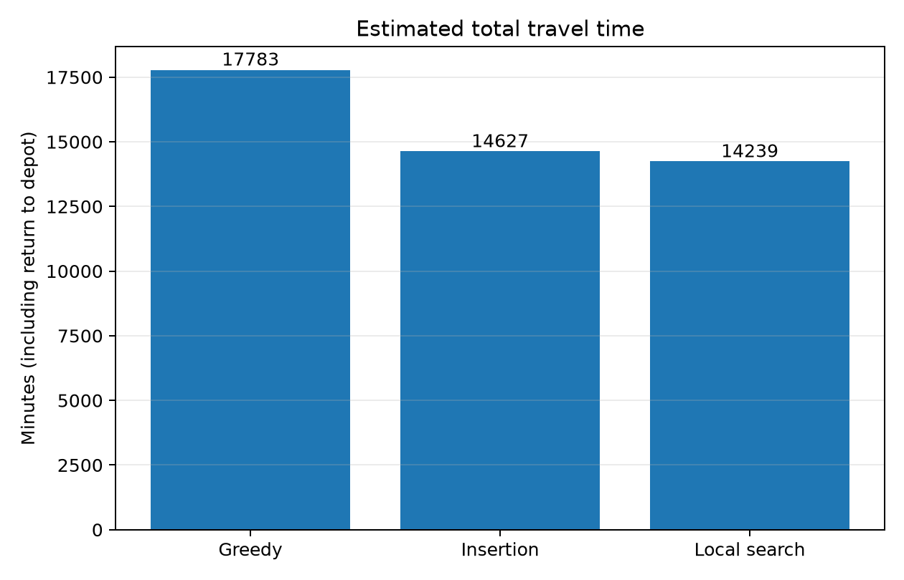
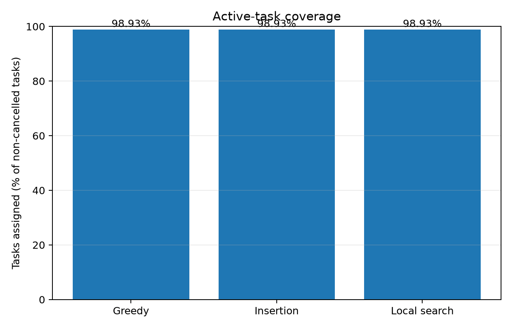
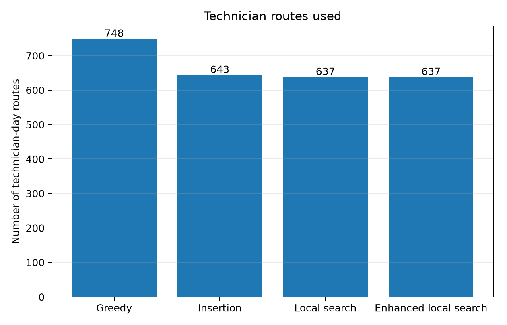
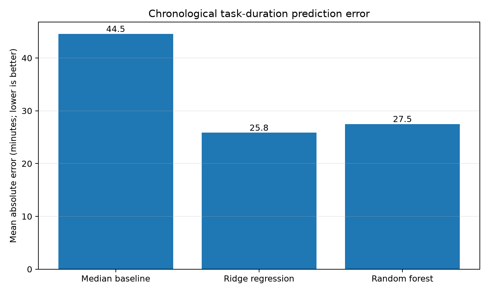

# Machine Learning and Scheduling Optimization for Field-Service Operations
## A research prototype inspired by plumbing service chains

**Academic project report — Draft for review**

**Original project motivation:** Using ML to Improve Business of Chain of Plumbing Services Like Mr. Rooter Plumbing  
**Team:** Group 5  
**Institution / course:** [Add institution and course]  
**Faculty guide:** [Add name, if required]  
**Submission date:** [Add date]

> **Scope statement.** This report evaluates a technician-routing and scheduling prototype using the TDC Net telecommunications field-service instance published with Gamst and Pisinger's research. The downloaded data is **not plumbing-company data** and is not an internal dataset from Mr. Rooter Plumbing. The work therefore demonstrates methods on a related field-service scheduling problem; it does not establish measured business improvements for a plumbing company.

### Group details and contributions

Complete this table before submission. The course instructions require group-member details and relevant page numbers on the first page; add final page numbers after exporting this report to PDF.

| Member | Name | Enrollment number | Contribution | Report pages |
|---|---|---|---|---|
| 1 | [Add name] | [Add ID] | [Describe verified contribution] | [Finalize after pagination] |
| 2 | [Add name] | [Add ID] | [Describe verified contribution] | [Finalize after pagination] |
| 3 | [Add name] | [Add ID] | [Describe verified contribution] | [Finalize after pagination] |
| 4 | [Add name] | [Add ID] | [Describe verified contribution] | [Finalize after pagination] |
| 5 | [Add name] | [Add ID] | [Describe verified contribution] | [Finalize after pagination] |

---

## Abstract

Field-service businesses need to assign service tasks to qualified technicians while respecting work shifts, task time windows, task durations and travel times. These decisions are relevant to plumbing service chains, but evaluating a real plumbing business requires plumbing-specific operational data. This project builds and evaluates a research prototype using a publicly available telecommunications technician-routing instance from TDC Net.

The workflow parses technician and task records, validates identifiers and time fields, constructs travel-time matrices, and compares three baseline scheduling heuristics—append-only greedy scheduling, route insertion, and relocation-based local search—and a bounded route-order enhancement using intra-route swaps and 2-opt. The three baseline methods assigned 2,209 of 2,233 non-cancelled tasks (98.93% coverage). Estimated travel, including return-to-depot legs, decreased from 17,783 minutes with greedy scheduling to 14,627 minutes with insertion and 14,239 minutes with relocation local search. The enhanced route-order pass further reduced travel to 14,174 minutes while preserving the same 2,209-task assignment set, a 3,609-minute (20.30%) reduction relative to greedy scheduling. The enhanced schedule passed its validator with 28,261 checks and zero reported errors; the baseline comparison figures cover the three baseline methods.

Machine-learning experiments investigated task cancellation and duration estimation using chronological evaluation. Cancellation prediction was weak on the latest held-out tasks: a Random Forest identified only 1 of 82 cancelled tasks at the evaluated threshold. Ridge regression predicted the recorded duration field with a mean absolute error (MAE) of 25.83 minutes, compared with 44.55 minutes for a training-set median baseline. However, replacing supplied durations with model estimates did not improve scheduling outcomes in counterfactual experiments; it reduced coverage and introduced schedule-feasibility violations. A conservative 46-minute residual buffer reduced underprediction but increased point-prediction error and planned travel.

The strongest supported result is an improvement in estimated routing performance from the tested scheduling heuristics on this telecommunications instance. The ML models have not demonstrated an overall scheduling benefit. Further, the downloaded archive contains 1,430 technician-day records and 32 observed skill labels, differing from the paper's reported 720 workday technicians and 31 skills; this discrepancy remains unresolved. The project must therefore be presented as a field-service scheduling prototype inspired by plumbing service chains, not as a validated solution trained on plumbing-company records.

**Keywords:** field-service operations, technician routing and scheduling, greedy heuristic, route insertion, local search, duration regression, cancellation prediction, Streamlit dashboard.

## 1. Introduction

Plumbing service chains coordinate jobs across locations, time windows, technician qualifications and daily working hours. Poorly ordered jobs can increase travel, while unsuitable assignments can make appointments infeasible. Data-driven methods and scheduling heuristics can help evaluate these trade-offs when reliable job, technician and travel data are available.

A common mathematical abstraction is the technician routing and scheduling problem (TRSP). It involves assigning tasks to technicians subject to qualification, time and routing constraints. Gamst and Pisinger describe the TRSP and evaluate methods on benchmark information and real-life telecommunications data. Their published TDC Net instance includes tasks, workday technicians, skills, time windows, durations and travel-time information [1].

This project was motivated by the potential to improve the operations of a plumbing service chain such as Mr. Rooter Plumbing. However, the available dataset describes telecommunications field service. The project uses it to study transferable scheduling techniques and deliberately does not claim that the dataset represents plumbing jobs, costs, technicians, or business performance.

### 1.1 Problem statement

Given non-cancelled tasks with required skills, durations, time windows and eligible-technician lists, assign tasks to technician-day routes so that tasks remain within task and technician work windows and estimated travel is reduced. Compare simple and progressively more informed heuristics using consistent measures, then explore whether available task fields support useful machine-learning predictions.

### 1.2 Objectives

1. Parse and validate the source technician, task and travel-time records.
2. Construct travel-time matrices without loading the entire travel-time section into memory at once.
3. Implement greedy, route-insertion and relocation local-search scheduling heuristics.
4. Validate assignments, technician eligibility, route sequence, service durations, time windows, inbound travel and final depot-return travel.
5. Compare assigned tasks, coverage, route count and estimated travel time.
6. Evaluate cancellation classification and task-duration regression with a chronological hold-out.
7. Test the counterfactual effect of estimated durations on scheduling feasibility and outcomes.
8. Present the results through a local Streamlit dashboard and document limitations.

### 1.3 Research questions

- RQ1: How do route insertion and relocation local search compare with append-only greedy scheduling on estimated travel time while maintaining the same assigned-task set?
- RQ2: Does task-duration regression improve prediction error relative to a median baseline on the chronological test set?
- RQ3: Do predicted durations improve scheduling outcomes when substituted for the source-recorded durations?
- RQ4: How do dataset provenance, inconsistent published-versus-parsed counts, and prediction-time assumptions constrain the conclusions?

## 2. Dataset and data-quality assessment

### 2.1 Source and scope

The dataset was obtained from the Zenodo record associated with Gamst and Pisinger's article, *Decision Support for the Technician Routing and Scheduling Problem* [1, 2]. The TDC Net instance is based on real-life data from a Danish telecommunications infrastructure company, not a plumbing company. The publication defines workday technicians, task skill requirements, task duration, penalties for unserved tasks, time windows and travel costs.

The paper reports an instance with 720 workday technicians, 2,677 tasks, 31 skills and a five-day horizon [1]. The downloaded archive checksum was verified against the Zenodo-published checksum, but the parse of this archive yields a different technician-record and skill-label count. That difference is not resolved by this project.

### 2.2 Parsed data and unresolved discrepancy

| Diagnostic | Observed in the downloaded archive |
|---|---:|
| Task records | 2,677 |
| Technician-day records | 1,430 |
| Technician IDs | Unique, range 1–1,430 |
| Task IDs | Unique |
| Technician records per workday | 286 on each of five dates |
| Distinct skill labels in technician records | 32 |
| Distinct skill labels required by tasks | 32 |
| Skill labels appearing only on one side | 0 |
| Cancelled tasks | 444 |
| Non-cancelled tasks | 2,233 |
| Tasks with empty eligible-technician lists | 10 (7 non-cancelled, 3 cancelled) |
| Missing technician IDs referenced by tasks | 0 |

The observed workday dates were February 24–28, 2020, with 286 technician records per date. The labels observed in the skill vocabulary include TOTAL; this project counts it as an observed label and does not assume its intended semantics. The diagnostic found no skill labels that appeared only among technicians or only among task requirements.

**Unresolved discrepancy:** The downloaded archive yields 1,430 technician-day records and 32 observed skill labels, whereas the paper reports 720 workday technicians and 31 skills. The five-day horizon and 2,677 task count agree. The available diagnostics describe the downloaded rows but do not explain the count difference. Accordingly, this report reports the counts observed in the downloaded archive and does not claim exact reproduction of the paper's instance summary.

### 2.3 Task eligibility anomalies

Ten task records contain an empty source-provided eligible-technician list. Seven of those tasks are not cancelled. The diagnostic also found workday-technician records holding the required skill for each of these tasks, but it did not establish why the source eligibility lists are empty. Those records are retained and counted transparently. The scheduler cannot assign a task when its source candidate list is empty, so the resulting unassigned-task count should not be interpreted as proof that no possible assignment exists under a different eligibility construction.

### 2.4 Travel-time validation and matrix construction

The travel-time section was streamed and parsed by category. The scan reported 14,823,979 valid entries, with zero malformed entries, invalid typed ID references or negative values. The observed range was 0–446 minutes; the mean across the classified entries was 142.5625 minutes. The associated paper states that travel times are measured in minutes [1].

| Travel-time category | Observed entries |
|---|---:|
| Task to task | 7,166,329 (2,677 × 2,677) |
| Task to technician | 3,828,110 (2,677 × 1,430) |
| Technician to task | 3,828,110 (1,430 × 2,677) |
| Technician to technician | 1,430 observed self-pairs |
| **Total** | **14,823,979** |

The project builds three NumPy matrices locally: task-to-task (2,677 × 2,677), task-to-technician (2,677 × 1,430), and technician-to-task (1,430 × 2,677). The matrix builder uses missing-value placeholders and checks expected pair counts, identifier references, duplicates and missing pairs. The generated matrices are local files and are not committed to GitHub.

### 2.5 Cancellation label and feature leakage

The dataset contains 444 cancelled and 2,233 non-cancelled tasks. The modified timestamp is nonblank on exactly 444 task records, matching the cancelled-task count. Because this field is closely associated with the final cancellation state, it is excluded from the cancellation models as a leakage risk.

The diagnostic also found 486 tasks whose created timestamp is later than time_window_start. This matters for prediction-time design: a feature can only be used by a real model if it would have been available when the prediction was supposed to be made. The current prediction experiments are exploratory and do not prove a deployable workflow.

## 3. Methodology

### 3.1 Data preprocessing

The parser reads the downloaded ZIP archive, identifies technician and task sections, parses records into structured fields and writes technicians.csv and tasks.csv. Travel-time entries are processed separately due to their large number. The data-validation script checks required columns, unique identifiers, numeric durations, time-window consistency and JSON-list fields.

Cancelled tasks are excluded from the scheduling experiments. The task's source-provided relevant-technician list defines the eligible candidate set. This preserves the source's eligibility information instead of silently assigning technicians who are not included in that list.

### 3.2 Common scheduling rules

All three scheduling methods operate on the same task and technician data and travel-time matrices. Route evaluation calculates inbound travel, arrival time, service start, service finish and the final return trip to the depot. A route must satisfy the task's time window and the technician's working window, including the final return trip. Travel time is reported separately from scheduled service time.

The scheduling heuristics are not exact solvers and are not guaranteed to find a globally optimal route plan. An unassigned task means that the specific heuristic did not assign it under its implemented rules; it does not prove that no feasible assignment exists.

### 3.3 Greedy append-only scheduler

The baseline orders tasks using numeric priority, higher penalty, earlier task-window end and stable task ID. For each task, it attempts to append the task to an eligible technician-day route if the resulting route remains feasible. It is simple and deterministic, but it does not consider inserting a task between existing route stops.

### 3.4 Route-insertion scheduler

The insertion heuristic tests different insertion positions in eligible technician-day routes. It retains feasible insertions and chooses the feasible option with the lowest marginal travel cost according to its implementation. This permits a task to be placed before or between already scheduled tasks, often avoiding extra travel caused by append-only ordering.

### 3.5 Relocation local search

Local search starts from the validated insertion schedule. It tries moving one assigned task from its current technician-day route to another eligible, already-used technician-day route and tests candidate insertion positions. A move is accepted only if both resulting routes remain feasible and their combined travel decreases. The implemented experiment is capped at 100 accepted moves; a later attempt to use a higher cap proved too slow and did not produce a completed result. The reported local-search result is the completed 100-move run, not a proof of local or global optimality.

### 3.6 Scheduler validation

The validators check task-status accounting, cancellation exclusions, source eligibility, route-row consistency, contiguous route sequence, service timestamps, service duration, task and technician windows, inbound travel, final return travel and summary counts. The reported scheduling tables were previously validated with zero errors:
- Greedy: 28,482 validation checks.
- Insertion: 28,272 validation checks.
- Local search: 28,260 validation checks.

These are internal consistency and feasibility checks implemented in this repository. They do not prove global optimality or guarantee that every feasible assignment is found.

## 4. Scheduling results

### 4.1 Overall comparison

| Metric | Greedy append-only | Route insertion | Relocation local search | Enhanced route-order local search |
|---|---:|---:|---:|---:|
| Total task records | 2,677 | 2,677 | 2,677 | 2,677 |
| Cancelled tasks excluded | 444 | 444 | 444 | 444 |
| Active tasks | 2,233 | 2,233 | 2,233 | 2,233 |
| Assigned tasks | 2,209 | 2,209 | 2,209 | 2,209 |
| Unassigned tasks | 24 | 24 | 24 | 24 |
| Active-task coverage | 98.93% | 98.93% | 98.93% | 98.93% |
| Technician-day routes used | 748 | 643 | 637 | 637 |
| Estimated travel including return-to-depot legs | 17,783 min | 14,627 min | 14,239 min | **14,174 min** |
| Scheduled service time | 140,707 min | 140,707 min | 140,707 min | 140,707 min |
| Validation errors | 0 | 0 | 0 | 0 |

**Figure 1. Estimated total travel time by scheduling method.**

**Figure 2. Active-task coverage by scheduling method.**

**Figure 3. Number of technician-day routes used.**

If the embedded figures do not display in an exported document, insert the corresponding PNGs from results/figures/.

### 4.2 Interpretation

Route insertion reduced estimated travel from 17,783 to 14,627 minutes compared with greedy scheduling, a reduction of 3,156 minutes (17.75%). Relocation local search reduced travel by a further 388 minutes (2.65%) to 14,239 minutes. The enhanced route-order pass then reduced travel by another 65 minutes (0.46%) to **14,174 minutes**, while retaining 2,209 assigned tasks and 637 routes.

Across the tested sequence, the enhanced schedule reduces estimated travel by 3,609 minutes (20.30%) relative to greedy scheduling. The 65-minute enhancement is a modest incremental gain and should be interpreted as the result of a bounded heuristic, not a guarantee of further improvements on other instances.

All methods assigned the same task set in the reported comparison. This is an advantage for interpretation: the lower travel figures are not explained by dropping additional tasks. The local-search procedure preserved assignment coverage by design and accepted only feasible, travel-improving task relocations.

The estimated total travel is a model output computed from the instance's travel-time matrices and route sequences. It is not a measurement of real fuel use, payroll cost, emissions or plumbing-business savings. The three baseline figures in Figures 1–3 do not include the enhanced route-order pass; the fourth table column reports its separately validated result. These results support a comparison of the tested heuristics on this dataset only.

### 4.3 Unassigned-task interpretation

Twenty-four active tasks remain unassigned in each of the three scheduling results. The initial analysis found seven non-cancelled tasks with empty source-provided eligibility lists. In the greedy and insertion runs, the remaining 17 were reported as tasks for which the heuristic could not find a feasible assignment under its rules. These results should be reported as heuristic outcomes, not as proof that all 24 tasks are impossible to schedule.

## 5. Machine-learning experiments

The ML experiments investigate whether selected fields support prediction. These experiments are exploratory; the dataset does not establish that its duration field is realized service time, and it is not plumbing-specific.

### 5.1 Cancellation prediction

#### Random stratified hold-out (exploratory)

The first experiment used a stratified random 80/20 split with 2,141 training records and 536 test records. It excluded task ID and the modified timestamp. The test set contained 89 cancelled tasks.

| Model | Accuracy | Balanced accuracy | Cancellation precision | Cancellation recall | Cancellation F1 | ROC-AUC |
|---|---:|---:|---:|---:|---:|---:|
| Majority baseline | 0.8340 | 0.5000 | 0.0000 | 0.0000 | 0.0000 | 0.5000 |
| Logistic regression | 0.6959 | 0.6917 | 0.3112 | 0.6854 | 0.4281 | 0.7138 |
| Random forest | 0.8451 | 0.6732 | 0.5441 | 0.4157 | 0.4713 | 0.7540 |

The random split suggests some separability, but random splitting does not simulate prediction on future tasks. It is retained as an exploratory comparison, not the main cancellation conclusion.

#### Chronological hold-out (more deployment-oriented)

The temporal experiment sorted records by creation timestamp, trained on the older 80%, and tested on the newest 20%. The test set contained 536 tasks, including 82 cancelled tasks.

| Model | Accuracy | Balanced accuracy | Cancellation precision | Cancellation recall | Cancellation F1 | ROC-AUC |
|---|---:|---:|---:|---:|---:|---:|
| Majority baseline | 0.8470 | 0.5000 | 0.0000 | 0.0000 | 0.0000 | 0.5000 |
| Logistic regression | 0.4832 | 0.5201 | 0.1626 | 0.5732 | 0.2534 | 0.5227 |
| Random forest | 0.8470 | 0.5050 | 0.5000 | 0.0122 | 0.0238 | 0.6036 |

At the evaluated default threshold, Random Forest detected only 1 of the 82 cancelled tasks. Its accuracy equalled the majority baseline, which detected no cancellations. Logistic regression identified more cancellations but had many false positives and a low ROC-AUC of 0.5227.

**Decision:** Cancellation prediction is not reliable enough to present as the primary ML contribution. The chronological evaluation is the more relevant result to emphasize, while the random-holdout result can be described as exploratory. Future work requires a better-defined prediction decision time, features known at that time, more temporal data and an evaluation plan aligned with the intended operational decision.

### 5.2 Task-duration regression

Duration regression used the oldest 80% of tasks by creation timestamp for training (2,141 rows) and the newest 20% for testing (536 rows). The models estimated the recorded duration field using selected timestamp-derived fields and task attributes, excluding task ID, duration target, cancellation outcome and modified timestamp.

| Model | MAE (minutes) | RMSE (minutes) | Median absolute error (minutes) | R² |
|---|---:|---:|---:|---:|
| Training-set median baseline | 44.549 | 72.796 | 33.000 | -0.2248 |
| Ridge regression | **25.833** | **48.074** | 11.001 | 0.4659 |
| Random forest regression | 27.483 | 48.951 | 11.301 | 0.4462 |

Ridge had the lowest test MAE and RMSE among the tested models. Relative to the median baseline, Ridge reduced MAE by about 42.0% and RMSE by about 34.0% on this chronological split.

**Critical interpretation:** the source paper defines task duration as an input to the scheduling problem [1]. The project's regression result therefore shows that the recorded duration field can be estimated from the selected fields in this static instance. It does not prove that the field represents realized job time, or that predicting it at intake would improve business operations. The use case would only be justified if duration were genuinely unknown when the prediction is made and all model features were available at that moment.

### 5.3 Duration errors by job length

Prediction quality differed by recorded-duration range. For Ridge, the observed MAE was approximately 1.60 minutes for 1–15-minute tasks, 10.47 minutes for 31–60-minute tasks, 29.60 minutes for 61–120-minute tasks and 72.28 minutes for tasks longer than 120 minutes. The 16–30-minute bin contained only 16 test tasks and had an MAE of about 14.68 minutes. Longer-duration tasks are especially important to inspect because large errors can distort route feasibility.

The error analysis is available in results/duration_error_by_range.csv, with a corresponding plot in results/figures/duration_mae_by_range.png.

### 5.4 Counterfactual scheduling impact of raw duration estimates

In this experiment, Ridge estimates were used for 536 chronologically held-out tasks while older tasks retained their source-recorded durations. The generated insertion schedule was then replayed using source-recorded durations to test whether the route order would remain feasible under those durations. This is a counterfactual consistency check, not a measurement of real deployment performance.

| Metric | Insertion using source durations | Insertion using raw Ridge estimates on held-out tasks |
|---|---:|---:|
| Held-out duration MAE | Not applicable | 26.09 min |
| Assigned active tasks | 2,209 | 2,205 |
| Active-task coverage | 98.93% | 98.75% |
| Unassigned active tasks | 24 | 28 |
| Routes used | 643 | 640 |
| Planned travel | 14,627 min | 14,802 min |
| Routes with replay violations | 0 | 25 |
| Unique tasks with task-window or shift violations on replay | 0 | 38 |

The raw-prediction schedule assigned four fewer tasks, reduced coverage by about 0.18 percentage points, increased planned travel by 175 minutes (about 1.20%), and had 25 routes with replay violations affecting 38 tasks. Thus, this use of the duration model did not improve the measured scheduling outcomes.

### 5.5 Calibrated duration predictions

A second temporal experiment trained Ridge on the oldest 60% of tasks (1,606 rows), used the next 20% (535 rows) for residual calibration, and reserved the newest 20% (536 rows) for final testing. A nonnegative 90th-percentile residual buffer of 46 minutes was added to predictions to reduce underestimation.

| Test metric | Raw Ridge | Ridge plus 46-minute buffer |
|---|---:|---:|
| MAE | 24.80 min | 57.29 min |
| RMSE | 48.32 min | 64.70 min |
| R² | 0.4603 | 0.0326 |
| Underprediction rate | 38.99% | 10.63% |
| One-sided coverage | 61.01% | 89.37% |

The buffer reduced underprediction but substantially worsened ordinary point-prediction accuracy. It is a safety-versus-efficiency trade-off rather than an overall improvement in the duration model.

### 5.6 Counterfactual scheduling impact after calibration

| Metric | Insertion using source durations | Insertion using calibrated predictions on held-out tasks |
|---|---:|---:|
| Assigned active tasks | 2,209 | 2,198 |
| Active-task coverage | 98.93% | 98.43% |
| Unassigned active tasks | 24 | 35 |
| Routes used | 643 | 668 |
| Planned travel | 14,627 min | 15,855 min |
| Routes with replay violations | 0 | 11 |
| Unique tasks with task-window or shift violations on replay | 0 | 11 |

Compared with the raw-prediction counterfactual, the residual buffer reduced the number of violation-affected routes from 25 to 11 and the number of affected tasks from 38 to 11. However, compared with the source-duration plan, it assigned 11 fewer tasks, used 25 more routes and increased planned travel by 1,228 minutes (about 8.39%).

**Decision:** The calibrated estimates reduce but do not eliminate schedule-feasibility violations, while worsening coverage and planned travel relative to source durations. Neither duration-prediction approach has demonstrated an operational improvement in these experiments.

## 6. Interactive dashboard and reproducibility

The repository contains a Streamlit dashboard (app.py) with three sections:
1. **Scheduling overview:** scheduler comparison, metrics, plots and a downloadable comparison table.
2. **Route explorer:** inspect one technician-day route and filter task statuses when local route and status CSVs are available.
3. **ML experiments and limitations:** inspect duration-regression and cancellation-prediction findings.

Tracked aggregate ML metrics and results/scheduler_demo_summary.json allow the dashboard to show an aggregate overview even when local scheduler summaries are not present. Individual task and route exploration still depends on local generated CSV files. The demo summary is not source data and cannot regenerate routes or reproduce the full experiment.

### 6.1 Setup

Use Python with a virtual environment, then install the dependencies from the repository:

~~~powershell
git pull origin main
python -m pip install -r requirements.txt
python -m py_compile app.py
streamlit run app.py
~~~

### 6.2 Reproducing the data pipeline and experiments

The raw archive and processed data/matrices are excluded from Git. To reproduce from source, first obtain TDCData_instance.zip from the Zenodo record cited below, place it under data/raw/, and follow the relevant script sequence in the repository README. Do not commit the raw archive or generated NumPy matrices.

The core scheduling workflow is:
1. Run src/parse_tdc_records.py.
2. Run src/validate_processed_data.py.
3. Run src/investigate_dataset_semantics.py.
4. Run src/build_travel_matrices.py.
5. Run and validate the greedy scheduler.
6. Run and validate route insertion.
7. Use the completed bounded local-search result only when its generated outputs are available; do not rerun the higher move budget that was too slow.
8. Run src/compare_schedulers.py.

Each reported scheduler should be associated with a passing validator. The ML scripts and their tracked result metrics are under src/ and results/; see the README for the individual commands.

## 7. Limitations and threats to validity

1. **Domain mismatch:** The available data represents telecommunications field service, not plumbing work orders. Plumbing-specific service categories, parts, invoices, callback indicators, customer experience and real business costs are not modeled.
2. **Unresolved data-count discrepancy:** The downloaded archive parses into 1,430 technician-day records and 32 observed skill labels; the paper reports 720 workday technicians and 31 skills. The discrepancy has been documented but not explained.
3. **Observed rather than guaranteed optimality:** The scheduling methods are heuristics. Lower estimated travel among the tested methods is not proof of a global optimum.
4. **Eligibility list anomalies:** Ten tasks have empty source-provided eligible-technician lists. Seven are non-cancelled. These constrain assignment under the implemented candidate rules.
5. **Small time horizon:** The reported instance has a five-day horizon. Generalization to larger operations, other dates or other organizations has not been tested.
6. **Duration target ambiguity:** The paper treats duration as a scheduling input. The project does not establish that it is a realized duration available as a supervised-learning target in the intended real use case.
7. **Prediction-time assumptions:** Some creation timestamps occur after the task-window start. Realistic feature availability and cut-off time need additional justification.
8. **Cancellation class and temporal performance:** Cancellation prediction deteriorated in chronological evaluation, and the Random Forest detected one cancellation at the evaluated threshold.
9. **Counterfactual ML-scheduling evaluation:** Replay violations reveal risks when replacing supplied durations with predictions, but the result is not evidence about actual realized schedules.
10. **No measured financial savings:** Travel minutes from a benchmark instance have not been converted into real monetary, fuel, emissions or customer-service savings.

## 8. Conclusion

This project built a reproducible pipeline for a technician-routing and scheduling instance, validated task and travel-time data structures, implemented three baseline scheduling heuristics plus a bounded route-order enhancement, and evaluated exploratory ML models. On the downloaded instance, the enhanced schedule reported 14,174 estimated travel minutes, 637 routes, 2,209 assigned tasks, and 98.93% active-task coverage. This is 3,609 fewer travel minutes (20.30%) than the greedy baseline. The enhanced schedule passed 28,261 internal validation checks with zero errors; these checks do not prove global optimality.

The ML experiments produced a more cautious outcome. Ridge regression reduced duration-prediction error compared with a median baseline, but using the predictions inside the scheduling workflow failed to improve results and introduced feasibility violations. Conservative residual calibration reduced underprediction and replay violations, but it worsened MAE, reduced coverage and increased planned travel. Cancellation prediction was weak on the chronological hold-out. Accordingly, the project does not claim that ML improved operational outcomes.

The source-data discrepancy and domain mismatch should be stated plainly in any presentation or report. The supported conclusion is that the tested scheduling heuristics performed better than the greedy baseline on this downloaded telecommunications field-service instance. Plumbing-specific benefits remain a hypothesis requiring plumbing-company data or a prospective evaluation with an appropriate partner.

### 8.1 Future work

- Resolve the downloaded archive versus paper-summary discrepancy, ideally through author/source clarification or a documented source explanation.
- Obtain anonymized plumbing-company work orders if the academic objective requires claims about actual plumbing operations.
- Evaluate a scheduling improvement against a stronger benchmark or exact/near-exact method on manageable subsets.
- Define a realistic decision time and target before further ML development.
- Investigate more useful operational labels, only where supported by the data and available before a real decision.
- Add tests and environment/version information for reproducibility.
- Finish the course report export, presentation and help file, with verified group contributions, page numbers and citations.

## References

1. Gamst, M., & Pisinger, D. (2024). *Decision support for the technician routing and scheduling problem*. Networks, 83(1), 169–196. https://doi.org/10.1002/net.22188
2. Gamst, M., & Pisinger, D. (2023). TDC Net technician routing and scheduling dataset associated with *Decision support for the technician routing and scheduling problem*. Zenodo. https://zenodo.org/records/7904015
3. The project code and analysis outputs: https://github.com/SRV30/plumbing-ml-optimization

---

## Pre-submission checklist

- [ ] Confirm title and dataset scope with the supervisor.
- [ ] Explain or formally document the 1,430-versus-720 technician and 32-versus-31 skill discrepancy.
- [ ] Fill in all five group members' names, enrollment numbers and actual contributions.
- [ ] Add institution, course, faculty guide and submission date.
- [ ] Check every table/figure against the generated project output.
- [ ] Export the final report to PDF and add final page references to the first page.
- [ ] Prepare presentation slides and a help file with environment setup and run commands.
- [ ] Ensure the submitted code, report and dashboard all describe the telecommunications-data limitation honestly.
